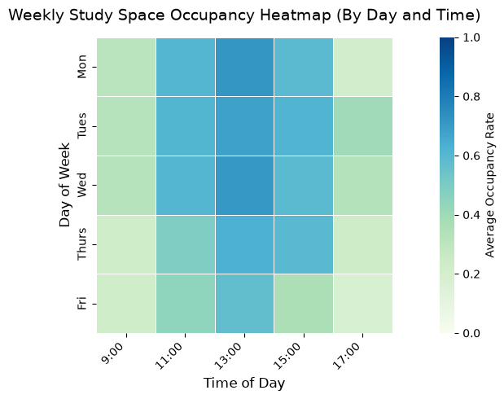
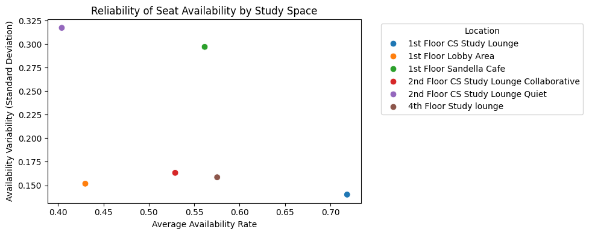
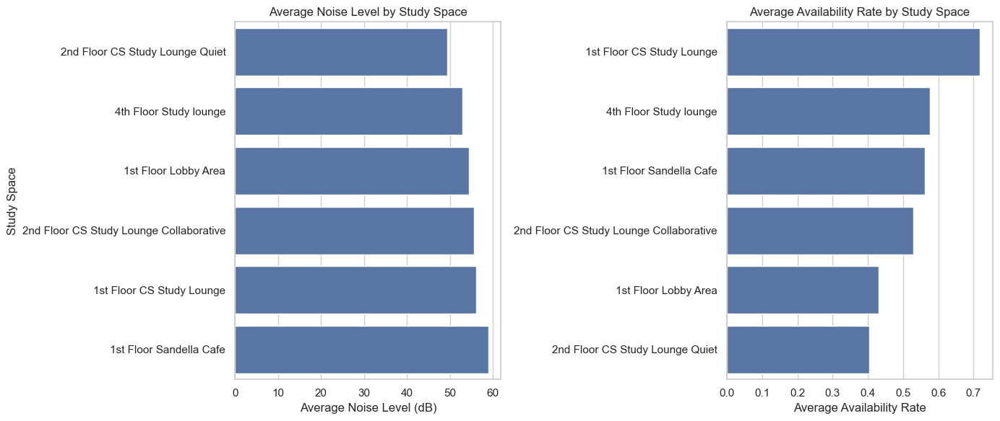
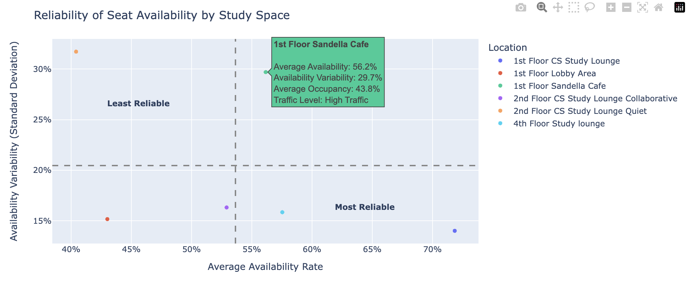

# Task 1: Revisit your data and questions
After reviewing our data and initial questions from Assignment 1, we refined some of our questions to better match the attributes available in the dataset. We narrowed our broad question about distraction-free studying into a more specific exploration of the relationship between noise and available seating, expanded our popularity question to focus on occupancy patterns across time and location, and replaced our weather-focused question with a comparison of high-traffic and low-traffic study spaces. That being said, we're moving forward with the following questions:

- Which study spaces are the most reliable for finding available space?
- Are the quietest study spaces also the hardest spaces to find a seat?
- How do occupancy patterns vary across location, time of day, and day of week?
- How do high-traffic and low-traffic study spaces differ from one another?

Additionally, we collected more observations to expand our dataset.

# Task 2: Prepare the data
We used Pandas to prepare and transform our data in this [notebook](Notebooks/Task_2_Data_Prep.ipynb). The first thing we did was combine the weather and study datasets using the date and time attributes. Next, we derived several attributes that would support analysis, which are capacity (sum of occupancy and open seats), occupancy rate (normalized due to different study space sizes), availability rate (normalized due to different study space sizes), day of week (derived from date), and traffic level (high traffic vs. low traffic based on surrounding pedestrian activity). Afterwards, we checked the summary statistics for capacity to make sure there weren't any major inconsistencies. During this time, we noticed that the 1st Floor Study Lounge had an oddly high max capacity that deviated a lot from the mean, so we went back to our original Google Sheet data to see if we missed something. We discovered that we mistyped a couple values, so we immediately went back to the csv file to fix that. Then, we filtered the observed times to only 9 AM, 11 AM, 1 PM, 3 PM, and 5 PM because some of the earlier observations we collected included times that were outside the scope of our finalized considerations. Lastly, we saved our transformations to a [csv dataset](Data/transformed_study_data.csv) of its own to use in upcoming analysis and visualizations.

# Task 3: Explore the data
## Exploratory Visualization 1
We wanted to explore how occupancy rates change throughout the day across different study spaces. We noticed that most study spaces had higher occupancy rates around 13:00 and lower rates by 17:00. The Second Floor CS Study Lounge (Quiet) had its highest occupancy at 13:00, reaching over 90%. On the otherhand, the First FLoor CS Study Lounge generally had lower occupancy rates than the other study spaces. We also noticed that occupancy rates were generally lower at 9:00, but then increased by late morning/early afternoon, and then decreased by 17:00.

## Exploratory Visualization 2

This scatterplot compares noise levels with seat availability rates across different study spaces. We wanted to explore seat availability and noise level's relationship. We noticed that the Second Floor CS Study Lounge (Quiet) was farther to the left, with noise levels around 38-50dB. On the otherhand, the First Floor Sandella Cafe and First Floor Lobby Area were farther to the right, with noise levels closer to 69dB.

Another finding is that the Second Floor CS Study Lounge and Sandella Cafe showed lower seat availability than most of the other locations. We also noticed that theses study spaces have fewer seats than some of the other study areas, although the Fourth Floor Study Lounge was an exception to this pattern.

## Exploratory Visualization 3
We wanted to explore occupancy rates and noice level d  

# Task 4: Implement Visualization Alternatives
## Visualization #1

This heat map approaches the question, "How do occupancy patterns vary across location, time of day, and day of week?" This is based off of the sketch from assignment #1 of a heatmap. The heatmap shows an average occupancy rate across different 

Attempting to redo this for Curio
 - lost account; use username + password and said it was wrong
 - 502 error
 - offline twice within 10 minutes

## Visualization #2

This scatterplot addresses the question "Which study spaces are the most reliable for finding available space?" We used this approach because reliability can be determined by comparing average (mean) availability rates to availability variability (standard deviation), allowing us to view both availability and consistency across different locations. The dimensions of a scatterplot allow us to easily view those simultaneously. To elaborate, the most reliable locations would balance both high average availability and low availability variability. That being said, the attributes we used in this visualization are location, availability rate, average availability rate, and the standard deviation of availability rate. We used average availability rate to represent how often seats are typically available and standard deviation to measure how much availability fluctuates across observations. The marks we used are points, which represent locations in the CDRLC. The channels are position (x and y) and colors for each point. Furthermore, this scatterplot is an entirely new design that we didn't sketch in Assignment 1. We didn't want to implement our original sketch for this question because in that sketch, we used the sizes of circles to represent different availability rates on a spatial map, but it's harder to distinguish those visually.

 ## Visualization #3

This visualization supports the question "Are the quietest study spaces also the hardest spaces to find a seat?" We used this approach to compare rankings of study spaces based on average noise level and average seat availability side-by-side. The data attributes that this visualization uses are location, average noise level, and average availability rate. The marks we used are bars, and the channels are length of the bars to represent average noise level or average availability rate and vertical positions to rank the study spaces by attributes. There are also two charts that are side-by-side to aid with making attribute comparisions. Although we initially considered creating a scatterplot visualization, we realized that we wanted a unique visualization that emphasized ranking and direct comparisions between study spaces. Therefore, creating ranked bar charts was the most straightforward way of accomplishing this. However, one thing we noticed is that this visualization involves aggregation, which is a source of uncertainty because we aren't able to see more detailed variation of the data over time or days. This is something we may potentially address in the upcoming tasks.

# Task 5: Interaction and Multiple Views

## Visualization #2
We believe that this visualization would benefit from interaction, specifically details-on-demand. By simply looking at the scatterplot's points, it's generally not straightforward to determine exact values. To address this, we want to implement the ability to display additional information when a user hovers their cursor over a point. That information would include study spot location, average availability rate, availability variability, average occupancy rate, and traffic level. This interaction would also allow users to quickly inspect the data without the additional information cluttering the overall view of the data.

## Visualization #3
This visualization uses two coordinated views, which displays separate ranked bar charts for average noise level and average availability rate. The two charts show the same study spaces ordered by different criteria, allowing users to compare rankings side-by-side. This supports our task of determining whether quieter study spaces also tend to have lower seat availability. Furthermore, we also want to incorporate a details-on-demand through hovering. We want to move forward with this approach because we noticed how some of the bars have similar lengths, making it hard to determine exact values from visual inspection alone. Implementing this would look like users hovering over a bar and the exact average noise level or average availability rate getting displayed. This would help users make more precise value comparisons while maintaining a clean visualization look.

# Task 6: Iterate and Refine

## Visualization #2

Iteration 1: Details-on-Demand Interaction

A problem we noticed is that it was difficult to determine exact values from the original scatterplot. To address that, we added those values and extra information to each point to improve readability. We also made the visualization interactive, meaning that users can hover their cursor over each point to display the additional details. This helps reduce clutter while making the visualization more informative and supporting more precise comparisions between study locations.

Iteration 2: Reliability Quadrants

Another problem we discovered is that the visualization didn't clearly indicate which locations were more or less reliable. As a result, we added horizontal and vertical grid lines at the mean availability and mean variability values, creating four interpretation regions. We also included labels identifying the "Most Reliable" and "Least Reliable" regions. The overarching purpose of making those changes were to make it easier to identify study spaces with above-average availability and below-average availability, assisting users with interpreting reliability quickly and consistently.

# Task 7: Current Design
